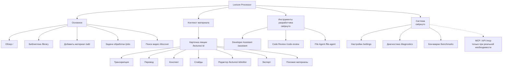

# UX-2. Новая информационная архитектура

Цель — сделать основным сценарием «добавить видео → получить готовый текст и
DOCX», не потеряв административные и AI-инструменты. Документ описывает
**целевую структуру** и то, как она ложится на существующие маршруты.

> **Статус: решения UX-1 утверждены владельцем проекта.**
> Реализация UX-2 может начинаться по этому документу. Детальный технический
> план — `07-ux2-technical-plan.md`; отложенные вопросы —
> `05-implementation-roadmap.md`, раздел «Отложенные задачи».

---

## 0. Утверждённые решения UX-1

1. **Support Assistant не входит в основной интерфейс.** Backend, `/support`,
   тикеты, API и данные сохраняются. Отдельный пользовательский раздел
   «Помощь» удаляется из навигации, потому что его единственное назначение —
   Support Assistant. Прямые URL остаются рабочими.
2. **Основная навигация:** Обзор, Библиотека, Добавить материал, Задачи
   обработки, Поиск видео.
3. **Контекст материала:** Карточка лекции, Транскрипция, Перевод, Конспект,
   Слайды, Редактор, Экспорт, Похожие материалы. Это навигация внутри
   контекста лекции, а не глобальные пункты sidebar.
4. **Инструменты разработчика** (свёрнутая группа): Developer Assistant,
   Code Review, File Agent.
5. **Система** (свёрнутая группа): Настройки, Диагностика, Бенчмарки.
   MCP/API попадает в UI-навигацию только если действительно нужен
   пользовательский переход; по умолчанию остаётся техническим маршрутом.
6. **Новые UI-маршруты разрешены:** `/library`, `/add`, `/jobs`. Существующие
   маршруты и backend API сохраняются; новые страницы переиспользуют
   существующие сервисы и не создают параллельную бизнес-логику.
7. **Разрешены точечные исправления ложных/устаревших подписей:** Ollama — не
   cloud; устаревшее сообщение о неработающем Code Review; непонятные
   технические названия статусов. Реальные ошибки и противоречия в данных не
   скрываются.

---

## 1. Принципы

1. **Одна главная задача — одна дверь.** Добавление материала начинается с
   одного заметного действия, а не с трёх конкурирующих форм.
2. **Библиотека ≠ документация проекта.** Обработанные лекции и документация
   для Developer Assistant — разные сущности и разные разделы.
3. **Прогрессивное раскрытие.** Обычный пользователь видит язык, результат,
   слайды и базовые опции; модели, temperature, prompt, provider, tokens —
   только в «Расширенном режиме» / администрировании.
4. **Один источник правды для статуса.** Пользователь видит одну человеческую
   стадию и одно действие; технические `PENDING/COMPLETED` — в «Детали».
5. **Один primary action на экран.** Нельзя ставить рядом «Обработать заново»
   и «Возобновить», если они делают одно и то же.
6. **Ошибка — это сценарий, а не текст.** У каждой ошибки есть причина,
   следующее действие и fallback.
7. **Существующие URL и API сохраняются.** Новая IA сначала выражается
   навигацией и компоновкой, а не переписыванием контроллеров.

---

## 2. Роли

| Роль | Кто | Что нужно | Что не должно мешать |
|------|-----|-----------|----------------------|
| **Пользователь** | человек, который приносит лекцию и хочет текст | добавить, дождаться, прочитать/поправить, скачать, найти похожее, получить помощь | провайдеры, MCP, бенчмарки, диагностика, токены |
| **Администратор установки** | владелец инстанса | ключи, модели, диагностика, бенчмарки, безопасность | пользовательские лекции |
| **Разработчик / power user** | работа с репозиторием и агентами | Developer Assistant, Code Review, File Agent, MCP | основной сценарий лекций |
| **Поддержка (вне UI)** | прямой переход по `/support` | Support Assistant, тикеты | не показывается в основной навигации и не является частью пользовательских сценариев |

В приложении пока **нет полноценных пользовательских аккаунтов**: существует
админ-токен и loopback-доступ (`AdminSecurityFilter`). Поэтому разделение ниже —
**навигационное и информационное**, а не новая система авторизации. Нельзя
обещать «роли», которых нет в backend; можно скрывать/сворачивать разделы и
оставлять существующую защиту `/settings`.

---

## 3. Целевая карта разделов



Support Assistant (`/support`) в карте отсутствует намеренно: он остаётся
доступным по прямому URL, но не является разделом интерфейса.

### 3.1. Основное

| Раздел | Зачем | Кто | Действия | Существующие страницы |
|--------|-------|-----|----------|-----------------------|
| **Обзор** `/` | рабочая панель: добавить, продолжить, увидеть проблемы | пользователь | добавить файл/URL, открыть последнее, возобновить/повторить, перейти в библиотеку | `index.html` (переработать) |
| **Библиотека** `/library` | найти и открыть материал, фильтры, карточки | пользователь | поиск, фильтры, сортировка, открыть лекцию/редактор | вынести из `index.html`; `LectureLibraryService` уже есть |
| **Добавить материал** `/add` | единый мастер импорта | пользователь | файл, URL, найденное видео, базовые/расширенные опции | формы на `index.html`, `/lectures/preview`, `/discover` |
| **Задачи** `/jobs` | все активные/завершённые обработки в одном месте | пользователь | смотреть прогресс, отменять, возобновлять, открыть результат | данных достаточно в `pipeline_job`, `stage_checkpoint`, `lecture`; нужен только read-only view |
| **Поиск видео** `/discover` | найти внешнее видео и импортировать | пользователь | поиск, похожие, импорт | `discover.html` |

«Задачи» — **не новый backend-контракт**: это агрегирующий экран поверх уже
существующих `GET /api/lectures`, `GET /api/lectures/{id}/progress`,
`pipeline_job` и `JobStatusService`. Маршрут `/jobs` утверждён; отдельная
бизнес-логика не создаётся.

### 3.2. Материал (контекстная навигация)

Карточка лекции — хаб. Вкладки не должны дублировать редактор:

| Вкладка | Что показывает | Редактирование |
|---------|----------------|----------------|
| **Обзор** | название, источник, язык, длительность, статус, артефакты, предупреждения, следующий шаг | нет |
| **Транскрипция** | таймкоды + текст, поиск, скачать Markdown/JSON | кнопка «Редактировать» → редактор |
| **Перевод** | исходный/переведённый текст, статусы сегментов, предупреждения | кнопка «Редактировать» → редактор |
| **Конспект** | Markdown-просмотр + скачать DOCX/MD | кнопка «Редактировать» → редактор |
| **Слайды** | изображения с таймкодами | нет |
| **Экспорт** | варианты DOCX/Markdown, актуальность; история и сравнение — в редакторе | ссылка в редактор |
| **Похожие** | локальные похожие + переход в Discovery | нет |

«Редактор» (`/lectures/{id}/editor`) — отдельный пункт контекстной навигации,
а не вкладка карточки. Он остаётся отдельным маршрутом: в нём слишком
много состояния (dirty, revisions, conflict), чтобы встраивать его в карточку
без риска. В карточке — только чтение и один вход «Редактировать».

### 3.3. Support Assistant — вне основной навигации

Решение UX-1: **не удалять и не редизайнить** Support Assistant.

| Что сохраняется | Что меняется |
|-----------------|--------------|
| `/support`, `/support/tickets/{id}`, `/api/support/**`, тикеты, сообщения, tool trace, метрики, миграции, тесты | не входит в sidebar, breadcrumbs, главную, библиотеку, мастер импорта и карточку лекции |
| прямой URL и существующие ссылки из внешней документации | отдельная группа «Помощь» удаляется из навигации |
| backend и данные | никаких изменений API/БД в UX-2 |

Правила:

- Support Assistant не является обязательной частью ни одного пользовательского
  сценария.
- Не добавлять его на главную, в библиотеку, мастер импорта или карточку
  лекции.
- Ссылки «Помощь по этой лекции» в карточке и редакторе удаляются из UI
  (прямой URL остаётся рабочим).
- Визуальный редизайн Support не выполняется.

**Технический долг (отдельная задача, не UX-2):** `GET /support/lecture/{id}`
создаёт тикет как побочный эффект GET. Это нежелательное поведение; исправление
не смешивать с рефакторингом layout. До исправления ссылку на этот маршрут не
возвращать в интерфейс.

### 3.4. Инструменты разработчика и Система

Две отдельные свёрнутые группы внизу sidebar. По умолчанию закрыты; состояние
раскрытия не является правами доступа.

| Группа | Страницы | Кому |
|--------|----------|------|
| **Инструменты разработчика** | `/assistant` (Developer Assistant), `/code-review`, `/file-agent` | разработчик / power user |
| **Система** | `/settings`, `/diagnostics`, `/benchmarks`; `/mcp` — только если реально нужен UI-переход | администратор |

Правила:

- Developer Assistant индексирует `README.md` и `docs/` проекта — **никогда** не
  смешивается с библиотекой лекций.
- `MCP` — техническая документация/JSON. По умолчанию не показывается в
  навигации; маршрут `/mcp` сохраняется и доступен по прямому URL.
- `/settings` внутри делится на вкладки: **Провайдеры**, **Модели по задачам**,
  **Перевод и глоссарий**, **Discovery-ключи**, **Безопасность**.
- `/benchmarks` внутри: **Запуск**, **История**, **Сравнение**, **Расходы**.
- `/diagnostics` — статус + «что сделать» + повторная проверка.
- Support Assistant в эти группы не включается.

---

## 4. Навигация

### Desktop

```
┌──────────────────────────────────────────────────────────────┐
│ [Logo] Lecture Processor     [Расширенный режим]  [Добавить] │
├──────────────┬───────────────────────────────────────────────┤
│ ОСНОВНОЕ     │                                               │
│  Обзор       │                                               │
│  Библиотека  │              content                          │
│  Добавить    │                                               │
│  Задачи      │                                               │
│  Поиск видео │                                               │
│              │                                               │
│ ▸ Инструменты│                                               │
│   разработчика│                                              │
│              │                                               │
│ ▸ Система    │                                               │
└──────────────┴───────────────────────────────────────────────┘
```

- Sidebar 240 px, sticky; активный пункт подсвечен и имеет `aria-current`.
- Группа «Контекст материала» не занимает sidebar глобально: она появляется
  как контекстная навигация внутри `/lectures/{id}` (вкладки/подраздел).
- Верхняя панель: breadcrumb (на внутренних страницах), глобальная кнопка
  «Добавить материал», индикатор сборки (`/api/app/version`) — только в админ-
  режиме или в «О системе».
- «Расширенный режим» — переключатель видимости технических деталей
  (модели, токены, ID) на страницах; хранится в `localStorage`, не является
  правами доступа.
- Группы «Инструменты разработчика» и «Система» свёрнуты; ссылки ведут на
  существующие защищённые маршруты (при отсутствии доступа `/settings` сам
  отправит на login).
- Support Assistant не имеет пункта меню и не входит ни в одну группу.

### Mobile

- Sidebar → drawer по кнопке-гамбургеру; закрывается по Esc/overlay.
- Верхняя панель: логотип, «Добавить», меню.
- Вкладки карточки — горизонтальный скролл с доступными кнопками, не `div`.
- Таблицы → карточки или горизонтальный скролл внутри контейнера, не всей
  страницы.

---

## 5. Что объединяется, что разделяется, что скрывается

### Объединить

| Сейчас | Станет |
|--------|--------|
| Две формы URL на `/` + импорт в `/discover` | один мастер `/add` с источником «файл / ссылка / найденное видео»; существующие POST-endpoints используются внутри |
| Таблица библиотеки и фильтры на `/` | отдельная `/library`; на `/` — только последние/активные |
| `/lectures/{id}` + `/editor` | карточка = чтение и статус; редактор = отдельный режим правки, один вход |
| `/settings` (провайдеры + задачи + перевод + глоссарий + discovery) | вкладки одной страницы |
| `/benchmarks` (запуск + история + сравнение + usage) | вкладки одной страницы |
| Support «Новое обращение» и «Свободный вопрос» | не входит в UX-2; существующий экран не перерабатывается |

### Разделить

| Что | Почему |
|-----|--------|
| Библиотека лекций и Developer Assistant | разные корпуса: `lecture_chunk` vs `doc_chunk`; смешение ломает доверие и поиск |
| Пользовательская поддержка и Developer Assistant | разные аудитории и инструменты |
| Пользовательские действия и админ-инструменты | не перегружать главную |
| Чтение документа и его редактирование | снижает риск случайных правок и конфликтов |

### Скрыть за «Расширенным режимом» / админ-разделом

- provider/model, `temperature`, `maxTokens`, `contextWindow`, `thinking`,
  `prompt template`;
- `tokens`, `estimated cost`, `confidence`, `grounded`, `relevanceBasis`;
- сырые `PENDING/COMPLETED/FAILED` этапов, `MCP`, `tool trace`, `embedding`;
- MCP/API endpoint, диагностические пути, версии инструментов;
- бенчмарки и Code Review (остаются доступны, но не в основном меню).

---

## 6. Маршруты: целевое соответствие

| Новый раздел | Целевой URL | Существующий URL | Стратегия |
|--------------|-------------|------------------|-----------|
| Обзор | `/` | `/` | переработать шаблон |
| Библиотека | `/library` | `/` (таблица) | утверждённый read-only UI-маршрут поверх `LectureLibraryService`; таблицу с главной убрать |
| Добавить | `/add` | формы на `/` | утверждённый мастер; POST и preview остаются существующими endpoint'ами |
| Задачи | `/jobs` | нет | утверждённый read-only экран поверх `pipeline_job`/`JobStatusService` |
| Карточка | `/lectures/{id}` | `/lectures/{id}` | сохранить |
| Редактор | `/lectures/{id}/editor` | `/lectures/{id}/editor` | сохранить |
| Чат по лекции | `/lectures/{id}/chat` | `/lectures/{id}/chat` | сохранить; в утверждённую контекстную навигацию UX-1 не включать |
| Discovery | `/discover` | `/discover` | сохранить |
| Support Assistant | — (прямой URL) | `/support`, `/support/tickets/{id}` | сохранить backend и страницы; убрать из навигации и карточки лекции |
| Developer Assistant | `/assistant` | `/assistant` | сохранить, перенести в админ-группу |
| Code Review | `/code-review` | `/code-review` | сохранить |
| File Agent | `/file-agent` | `/file-agent` | сохранить |
| Настройки | `/settings` | `/settings` | сохранить, разбить вкладками |
| Диагностика | `/diagnostics` | `/diagnostics` | сохранить |
| Бенчмарки | `/benchmarks` | `/benchmarks` | сохранить |
| MCP | `/mcp` | `/mcp` | оставить техническим; в UI-навигацию не добавлять без реального сценария |

**Статус маршрутов:** `/library`, `/add`, `/jobs` **утверждены** (UX-1).
Существующие маршруты и backend API сохраняются. Новые страницы — тонкие
view-контроллеры поверх `LectureLibraryService`, `PipelineJobRepository`,
`JobStatusService` и существующих POST-endpoint'ов; дублирования бизнес-логики
нет.

Support-маршруты сохраняются, но не входят в карту навигации. `GET /mcp`
остаётся техническим.

---

## 7. Поиск и «база знаний»

Сейчас есть:

- библиотека лекций (поиск по filename/теме, RAG-темы);
- чат по одной лекции (RAG по `lecture_chunk`);
- похожие лекции (cosine по embeddings);
- Developer Assistant (RAG по документации проекта, `doc_chunk`);
- Support Assistant (RAG по support-документации + тикеты).

**Отдельного пользовательского экрана «База знаний» с глобальным поиском по
всем лекциям в коде нет.** Нельзя рисовать его как существующий. Решение UX-1:
глобальный RAG-поиск по лекциям — **отложенная задача без реализации сейчас**;
отдельный раздел «База знаний» не добавляется, пока нет пользовательского
сценария. В первой итерации:

- «Похожие материалы» и «Чат по лекции» остаются внутри карточки;
- библиотека ищет по названию/теме, как сейчас;
- глобальный RAG-поиск по всем лекциям — будущая функция, требующая нового
  read-only API и отдельного UX-задания.

Developer Assistant и его `doc_chunk` не показываются в библиотеке и не
называются «базой знаний лекций».

---

## 8. Результат для пользователя

После рефакторинга пользователь должен уметь без инструкции:

1. Нажать «Добавить материал» на главной.
2. Вставить ссылку или выбрать файл, увидеть превью и понятные опции.
3. Запустить обработку и увидеть одну человеческую стадию.
4. Открыть готовый конспект и скачать DOCX.
5. При необходимости поправить текст и сохранить версию.
6. Найти похожие материалы.
7. При ошибке — понять причину и нажать «Повторить»/«Загрузить файл»/
   «Открыть диагностику».

Администратор при этом не теряет ни одной существующей функции: все текущие
страницы остаются доступны, но перестают быть частью основного сценария.
