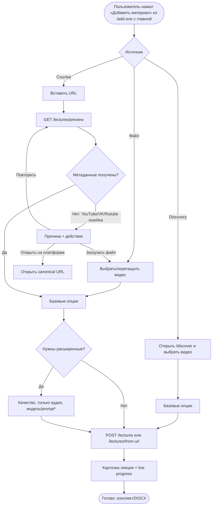
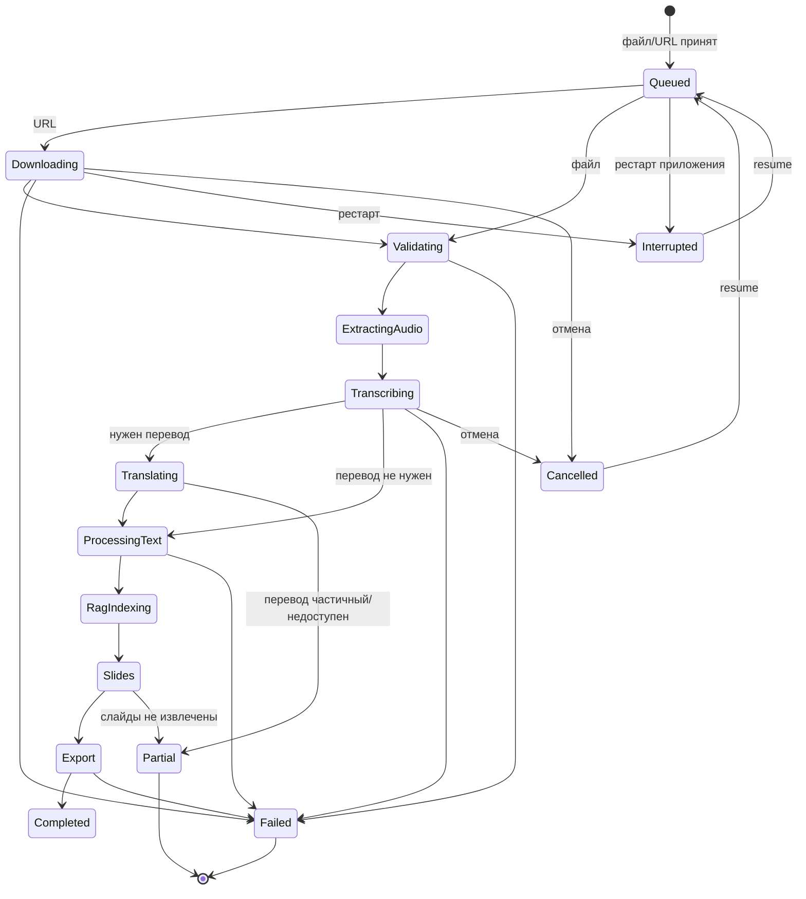
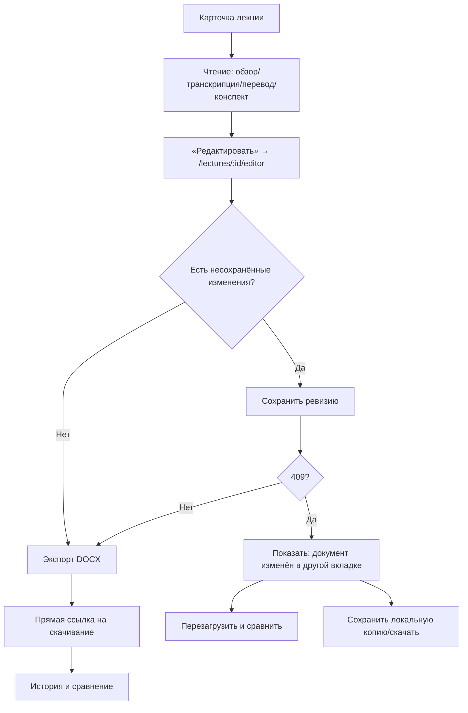
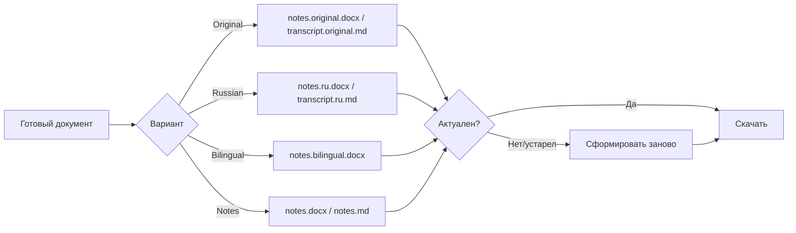
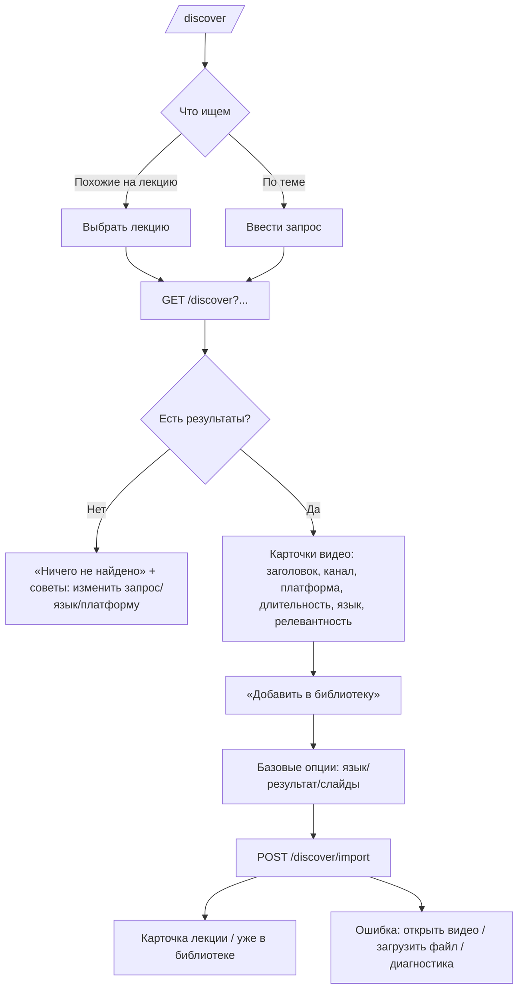
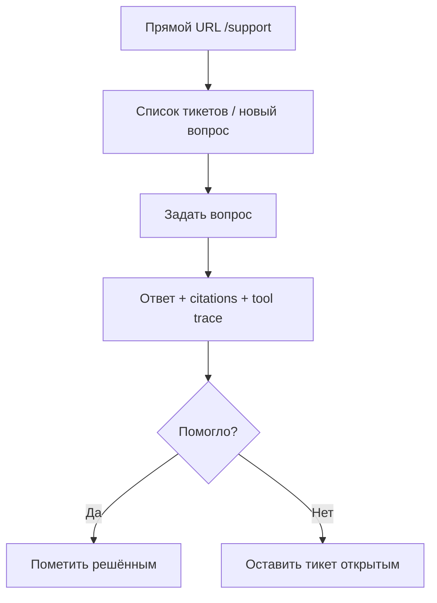
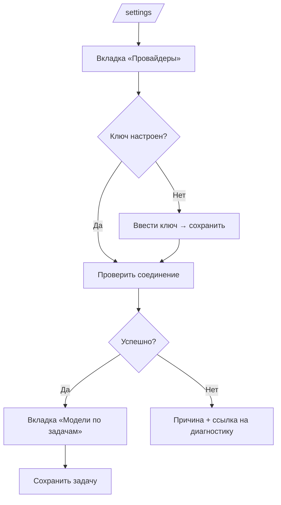

# UX-3. Пользовательские сценарии и состояния

Документ описывает целевые потоки. Он опирается только на существующие
возможности и endpoint'ы; всё, что требует нового API, помечено явно.

> **Статус: решения UX-1 утверждены.** Основная навигация и маршруты
> `/library`, `/add`, `/jobs` согласованы. Support Assistant исключён из
> основных сценариев (прямой URL сохраняется). Отложенные сценарии — в конце
> документа. Технический план UX-2 — `07-ux2-technical-plan.md`.

---

## 1. Добавление материала

### 1.1. Целевой поток

\* Модель/prompt в существующем backend задаются глобально в `/settings` и не
передаются per-job из UI. Показывать их в мастере можно только как ссылку
«Модель обработки: Ollama / qwen3:1.7b → изменить в настройках». Нельзя
рисовать несуществующий per-job выбор.

**Маршрут:** мастер живёт на `/add` (утверждено UX-1). Главная содержит
короткий блок «Добавить материал» с переходом в мастер и последними/активными
задачами; вторая полноценная форма URL на главной не сохраняется.

### 1.2. Базовые и расширенные опции

| Базовые (видны всегда) | Расширенные (accordion «Дополнительно») |
|------------------------|------------------------------------------|
| Источник: файл / ссылка / найденное видео | Качество: `auto/480p/720p/1080p` |
| Язык оригинала: `Авто`, `Русский`, `Английский` | Только аудио (для URL) |
| Результат: `Только оригинал`, `Перевести на русский`, `Двуязычный` | Очистка транскрипта |
| Слайды: `Не извлекать` / `Извлечь` | Модель/провайдер (ссылка в настройки) |
| | Prompt template (только advanced/admin) |

Убрать отдельный чекбокс «авто-перевод EN» из базового уровня: режим
`Перевести на русский` уже выражает намерение. Авто-перевод можно оставить
только как advanced-опцию для сценария «переводить только английские лекции».

### 1.3. Ошибки и восстановление

| Ситуация | Сообщение пользователю | Действия |
|----------|--------------|----------|
| Неподдерживаемая платформа | «Этот сайт не поддерживается. Доступны YouTube, VK Видео, VK, Rutube.» | «Открыть видео», «Загрузить файл» |
| YouTube требует вход/бот-проверку | «Платформа не отдала видео без авторизации. Скачайте файл вручную и загрузите его.» | «Открыть видео», «Загрузить файл», «Диагностика» |
| Видео недоступно/удалено | «Видео недоступно на платформе.» | «Открыть видео», «Загрузить файл» |
| Нет FFmpeg/FFprobe | «Не найдены компоненты обработки медиа.» | «Открыть диагностику», «Повторить после настройки» |
| Файл слишком большой / формат | Конкретно: лимит/поддерживаемые форматы | «Выбрать другой файл» |
| Нет места на диске | «Недостаточно места в каталоге данных.» | «Диагностика», «Повторить» |

> **Отложено (UX-1):** поддержка локальных MP3/M4A/WAV. Сейчас мастер
> принимает видеофайлы; аудиоформаты не обещать в подписях и не добавлять в
> `accept`, пока backend не поддерживает их явно.

Существующий backend уже различает причины (`YtDlpFailure`, `reason`,
`retryable`, `MediaDownloadException`) и возвращает 502 с `reason`. UI должен
показывать человеческую формулировку, а техническую деталь — в «Детали».

---

## 2. Обработка лекции и статусы

### 2.1. Жизненный цикл

### 2.2. Человеческая модель статусов

| Внутренний статус | UI-подпись | Тон | Пояснение |
|-------------------|-----------|-----|-----------|
| `UPLOADED` | «В очереди» | neutral | материал принят |
| `DOWNLOADING` | «Скачивание» | info | только для URL; показывать % и ETA, если есть |
| `VALIDATING` | «Проверка файла» | info | FFprobe |
| `EXTRACTING_AUDIO` | «Подготовка аудио» | info | FFmpeg |
| `TRANSCRIBING` | «Распознавание речи» | info | Whisper |
| `TRANSLATING` | «Перевод» | info | может быть пропущено |
| `PROCESSING_TEXT` | «Составление конспекта» | info | LLM |
| `EXTRACTING_SLIDES` | «Извлечение слайдов» | info | опционально |
| `EXPORTING` | «Сохранение документов» | info | DOCX/MD |
| `COMPLETED` | «Готово» | success | все запрошенные результаты доступны |
| `PARTIAL` | «Готово частично» | warning | часть этапов не выполнена; перечислить, что именно |
| `INTERRUPTED` | «Прервано» | warning | приложение перезапускалось; можно продолжить без повторов |
| `CANCELLED` | «Отменено» | neutral | можно возобновить |
| `FAILED` | «Ошибка» | danger | показать причину и следующее действие |
| `JobState.QUEUED/RUNNING` | не дублировать отдельно | — | использовать одну подпись со стадией |
| `StageState.PENDING` (нет checkpoint) | «Ожидает» | neutral | не показывать как ошибку |
| `StageState.RUNNING` | «Выполняется» | info | |
| `StageState.COMPLETED` | «Готово» | success | |
| `StageState.FAILED` | «Ошибка» | danger | |
| `StageState.CANCELLED` | «Отменено» | neutral | |
| `StageState.INVALIDATED` | «Нужно пересчитать» | warning | после правки/смены настроек |

### 2.3. Правила отображения прогресса

1. **Одна шкала.** Показывать `completedStages / requestedStages`, а не
   смешивать `currentStage.ordinal + 1` и число checkpoint'ов. Если stage
   пропущен по чекпоинту, он считается выполненным для прогресса.
2. **Не показывать 100% раньше готовности.** `COMPLETED`/`PARTIAL` — только
   после терминального состояния job.
3. **Не показывать `COMPLETED` рядом с `PENDING`.** `PENDING` в
   терминальном состоянии переводить в «Не выполнялось»/«Пропущено» или
   скрывать в «Детали».
4. **`PARTIAL`:** баннер «Что готово / что нет» + доступные артефакты.
5. **`INTERRUPTED`:** «Обработка была прервана. Продолжить с сохранённых
   этапов?» + одна кнопка «Продолжить».
6. **`FAILED`:** причина, «Повторить с проблемного этапа», «Открыть
   диагностику», при ошибке скачивания — «Загрузить файл».

### 2.4. Контекстные действия

| Состояние | Primary | Secondary | Опасное |
|-----------|---------|-----------|---------|
| В очереди/выполняется | «Отменить» | «Детали этапов» | — |
| Готово | «Скачать конспект DOCX» | «Открыть редактор», «Похожие», «Экспорт» | «Удалить» (с подтверждением) |
| Готово частично | «Посмотреть, что готово» | «Повторить недостающие этапы», «Диагностика» | «Удалить» |
| Прервано | «Продолжить» | «Детали» | «Удалить» |
| Ошибка | «Повторить» | «Диагностика», «Загрузить файл» (если download) | «Удалить» |
| Отменено | «Возобновить» | «Детали» | «Удалить» |

Кнопки «Обработать заново» и «Возобновить» не показываются одновременно.
Для повторного запуска используется одна кнопка с пояснением, какие этапы
будут переиспользованы.

---

## 3. Просмотр и редактирование

### 3.1. Требования к редактору

- Вкладки: **Оригинал / Перевод / Конспект / Слайды / История** — кнопки с
  `role="tab"`, `aria-selected`, клавиатурой ←/→/Home/End.
- Sticky toolbar: название документа, версия, индикатор «Не сохранено»,
  «Сохранить», «Отменить изменения», «Экспорт».
- Dirty-state: кнопка сохранения неактивна без изменений; при уходе со
  страницы — `beforeunload`; при переключении вкладки изменения не теряются.
- Перевод: исходный и перевод рядом (две колонки на desktop, последовательно
  на mobile), фильтры по `WARNING/MANUAL/STALE/UNREVIEWED`, статус сегмента
  текстом и цветом.
- Конспект: Markdown + безопасный preview (существующий `/notes/preview`), без
  WYSIWYG.
- Сохранение: одна кнопка на документ, optimistic revision; конфликт 409 —
  отдельный диалог, а не общий flash.
- История: «Сравнить версии» (from → to) и «Восстановить эту версию» рядом с
  выбранной строкой; подписи без «От/До».
- Экспорт: после генерации показывать прямую ссылку `Скачать` и статус
  «актуален/устарел», не только текст с именем файла.
- Для длинных лекций — не рендерить все textarea сразу: пагинация по 50–100
  сегментов или `content-visibility`, не меняя API.

### 3.2. Что не делать

- Не делать WYSIWYG для Markdown/DOCX: формат хранится как Markdown и
  сегменты, риск потери разметки высок.
- Не объединять редактор и карточку в один экран: конфликты и dirty-state
  станут неуправляемыми.
- Не менять API ревизий/экспорта.

---

## 4. Экспорт

Правила:

- На карточке — один блок «Документы» с 2–4 основными вариантами и
  «Все форматы».
- Не показывать ссылки, если артефакт не существует или статус `FAILED`/
  `CANCELLED`.
- Для `PARTIAL` показывать только доступные варианты и пометку «перевод
  неполный».
- Устаревший экспорт помечать и предлагать пересобрать; не удалять старый файл
  автоматически.
- В редакторе после экспорта — прямая ссылка на созданный файл.

---

## 5. Discovery

Требования:

- Релевантность объяснять: «совпадение по названию и описанию», не выдавать
  за анализ содержания.
- Не показывать 20 одинаковых форм с чекбоксами; одна карточка — одна кнопка
  «Добавить», опции в диалоге.
- Статус провайдеров — сворачиваемая панель «Источники поиска», не главный
  блок.
- Пустое состояние: что искать, какие платформы доступны, что делать, если
  провайдер недоступен.
- Ошибка импорта — панель с fallback на локальный файл (паттерн уже есть в
  `discover.html`).

---

## 6. Support Assistant — вне основных сценариев

Решение UX-1: Support Assistant **не является частью пользовательских
сценариев UX-2**. Backend, `/support`, тикеты и API сохраняются, но:

- в основной навигации нет раздела «Помощь» и пункта «Поддержка»;
- на главной, в библиотеке, мастере импорта и карточке лекции нет ссылок на
  Support;
- ссылка «Помощь по этой лекции» удаляется из карточки и редактора;
- прямой URL `/support` и `/support/tickets/{id}` остаются рабочими;
- визуальный редизайн Support не выполняется, существующие тесты сохраняются.

Текущее поведение прямого перехода (для справки, не целевое):

**Технический долг (отдельная задача):** `GET /support/lecture/{id}` создаёт
тикет побочным эффектом GET. Это нежелательное поведение; исправлять отдельно
от UX-2 и не смешивать с layout-рефакторингом. До исправления ссылку на этот
маршрут не возвращать в интерфейс.

---

## 7. Административные потоки

### 7.1. Настройка провайдера

- Ключи никогда не отображаются; только hint/status.
- Удаление ключа — confirm с явным последствием.
- «Проверить соединение» показывает понятный результат и время.
- Провайдер/модель для каждой задачи — отдельная карточка, без общих
  temperature-полей на первом уровне.

### 7.2. Диагностика

Поток: открыть → увидеть общий verdict → список проверок с «Что сделать» →
кнопка «Проверить снова» → ссылки в настройки/установку. Технические пути —
в «Детали». Не показывать сырые stack trace.

### 7.3. Бенчмарк

Поток: выбрать лекцию → preset/модель → запустить → увидеть статус → сравнить
два запуска → «Сделать рекомендованным». При пустой библиотеке объяснить, что
нужна хотя бы одна лекция; не показывать пустой `required` select.

---

## 8. Критерии готовности потоков

- Пользователь проходит «добавить → дождаться → скачать DOCX» без возврата на
  главную и без чтения технических терминов.
- Любая ошибка содержит причину и минимум одно следующее действие.
- `PARTIAL`/`INTERRUPTED` объяснены и имеют контекстное действие.
- Ни одна кнопка не дублирует другую по смыслу.
- Все состояния достижимы с клавиатуры и на ширине 390 px.
- Повторный запуск не создаёт второй экземпляр обработки и не теряет
  сохранённые ревизии.
- В основных потоках нет ссылок на Support Assistant.

---

## 9. Отложенные сценарии (не реализуются в UX-2)

| Сценарий | Почему отложен | Условие возврата |
|----------|----------------|------------------|
| Локальные MP3/M4A/WAV | backend рассчитан на видео и текущие проверки медиа; нужен отдельный сценарий загрузки аудио | явная поддержка в backend + UX-задание |
| Глобальный RAG-поиск по всем лекциям | нет пользовательского сценария и read-only API; нельзя рисовать несуществующий раздел «База знаний» | сформулированный сценарий + API-контракт |
| Исправление GET `/support/lecture/{id}` | побочный эффект GET вне scope UX-2 | отдельная задача с тестами |
| Визуальный редизайн Support Assistant | не входит в основной интерфейс | отдельное решение владельца |
