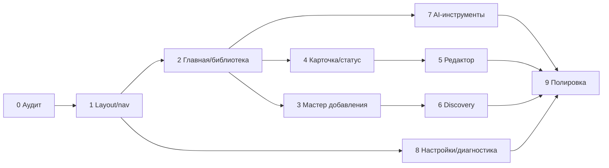

# UX-5. План реализации UX/UI-рефакторинга

План разбит на независимые этапы. Каждый этап можно останавливать и
демонстрировать. Backend API, схема БД, пайплайн и LLM-интеграции не меняются.
**Additive UI-маршруты `/library`, `/add`, `/jobs` утверждены** (UX-1);
подробный технический план первого этапа — `07-ux2-technical-plan.md`.

> **Решения UX-1:** Support Assistant исключён из основной навигации и не
> редизайнится (backend, `/support`, тикеты, API и тесты сохраняются).
> Отложенные задачи — раздел 14.

Обозначения объёма: **S** — 1–2 файла/день, **M** — 3–6 файлов, **L** — более
6 файлов или сквозной сценарий.

---

## 0. Базовый этап (уже выполнен)

- Аудит текущего UI, инвентаризация, браузерные проверки, документы `docs/ux`.
- Изменений кода нет.
- Критерий: документы готовы, рабочее дерево не содержит незакоммиченных
  изменений кода, пользовательские данные не тронуты.

---

## 1. UX-2: общий layout, навигация и дизайн-токены

**Этот этап детализирован в `07-ux2-technical-plan.md`.** Ниже — краткая
сводка и критерии приёмки; технический план имеет приоритет при реализации.

**Цель:** единая оболочка продукта, локальные ассеты, адаптивная база.

**Страницы:** все, кроме `/support` (Support Assistant не редизайнится и не мигрируется в общий shell).

**Файлы:**

- новые: `templates/fragments/layout.html`, `nav.html`, `flash.html`;
- новые: `static/css/tokens.css`, `base.css`, `components.css`;
- новый: `static/js/app.js`;
- новый: `static/vendor/htmx.min.js` (копия текущей версии);
- изменяются: 14 шаблонов (подключение layout, удаление inline `<style>`);
  `support.html` намеренно не меняется;
- `templates/settings-login.html`, `error.html` — тоже в общий layout
  (упрощённый вариант без sidebar).

**Изменения:**

1. `<meta name="viewport">`, `lang="ru"`, skip-link, `<main>`, `<nav>`.
2. Sidebar с группами «Основное / Инструменты разработчика / Система»;
   активный пункт. Support Assistant в навигацию не включается.
3. Topbar: «Добавить материал», breadcrumb, меню.
4. Локальный HTMX вместо CDN; fallback-сообщение, если JS не загрузился.
5. Удалить inline `<style>` из 14 мигрированных шаблонов; общие правила —
   в CSS, уникальные — в `pages.css`.
6. Единый flash-компонент (inline alert/toast).
7. Адаптив: drawer < 1024 px, таблицы — контейнеры со скроллом.

**Зависимости:** нет.

**Риски:**

- Thymeleaf layout без Layout Dialect: можно сломать `th:replace`/фрагменты.
  Митигация: сначала один шаблон (`index.html`), затем остальные; проверять
  рендер каждой страницы.
- Удаление inline-стилей может временно ухудшить вид: митигация — страница за
  страницей, не «всё сразу».
- Локальный HTMX: убедиться, что версия совпадает (1.9.12) и атрибуты не
  изменились.

**Критерии приёмки:**

- Все мигрированные GET-страницы отдают 200 и используют общий shell;
  прямой `/support` по-прежнему отдаёт 200 и не меняется.
- На 390 px нет горизонтального скролла страницы.
- HTMX работает без доступа к `unpkg.com`.
- Навигация доступна с клавиатуры, активный пункт имеет `aria-current`.
- Нет дублирования `<style>`.

**E2E:**

- все страницы открываются, заголовок и nav видны;
- мобильный viewport: нет `document.documentElement.scrollWidth > innerWidth`;
- offline-тест: заблокировать `unpkg.com`, проверить, что `window.htmx`
  определён (локальный файл);
- клавиатура: Tab до меню, Enter открывает страницу.

**Объём:** L.

---

## 2. Главная-панель и библиотека

**Цель:** главная отвечает на вопросы «что происходит», «что продолжить», «что
требует внимания»; библиотека — отдельный поиск.

**Страницы:** `/`, `/library`, `/jobs` (маршруты утверждены). Подробности —
`07-ux2-technical-plan.md`, §7.

**Файлы:**

- `templates/index.html`;
- новый `templates/fragments/lecture-card.html`, `empty-state.html`,
  `job-progress.html`;
- `static/css/pages.css`;
- additive view-контроллеры `GET /library` (поверх `LectureLibraryService`),
  `GET /jobs` (поверх `PipelineJobRepository`/`JobStatusService`), без
  изменения API.

**Изменения:**

1. Блок «Добавить материал»: dropzone + URL + кнопка «Найти видео».
2. Блок «Требует внимания»: FAILED / PARTIAL / INTERRUPTED с действиями.
3. Блок «Активные задачи»: прогресс, стадия, отмена/продолжить.
4. Блок «Последние материалы»: 6 карточек с названием, языком, статусом,
   доступными документами.
5. Пустое состояние первого запуска: 3 шага, поддерживаемые источники,
   кнопка «Добавить».
6. Библиотека: карточки/таблица с человеческими статусами, датами, фильтрами;
   поиск и сортировка сохраняются.
7. Задачи обработки: активные и недавние jobs, прогресс, контекстные действия
   через существующие POST-endpoint'ы.
8. Убрать технические метрики и длинные enum'ы с первого экрана.

**Зависимости:** этап 1.

**Риски:**

- Модель `index` уже содержит `items`/`lectures`; не добавлять новые запросы
  без необходимости.
- Не ломать существующие query-параметры (`q`, `language`, `status`,
  `hasTranslation`, `sort`) при выделении `/library`.
- `/jobs` не должен создавать новый job или дублировать действия.

**Критерии приёмки:**

- Пустая база: понятный onboarding, нет одинокой строки «Пока нет лекций».
- Заполненная база: видны активные задачи и последние материалы; библиотека
  доступна в один клик.
- Ошибка/partial видна на главной и ведёт к действию.
- Мобильный: карточки в одну колонку, фильтры в drawer/accordion.

**E2E:**

- пустая БД: виден onboarding и кнопка добавления;
- заполненная БД: 5+ карточек, переход в лекцию;
- FAILED-лекция: блок «Требует внимания» и кнопка «Повторить»;
- фильтры библиотеки сохраняются в URL и применяются.

**Объём:** L.

---

## 3. Единый мастер добавления материала

**Цель:** один сценарий «файл / ссылка / найденное видео» с базовыми и
расширенными опциями и восстановлением после ошибки.

**Страницы:** `/` (короткий блок-вход) и `/add` (маршрут утверждён); `/discover`
(кнопка «Добавить» ведёт в тот же мастер).

**Файлы:**

- `templates/fragments/add-material.html`;
- `templates/index.html`, `templates/discover.html`;
- `templates/fragments/url-preview.html` (переверстать);
- `static/js/app.js`, `static/css/pages.css`.

**Изменения:**

1. Три источника: файл (drag&drop), URL, «из Discovery».
2. Базовые опции: язык, результат, слайды.
3. Advanced accordion: качество, только аудио, очистка, ссылка на настройки
   модели.
4. URL preview с названием/каналом/длительностью/размером.
5. Ошибки: причина + «Повторить», «Открыть на платформе», «Загрузить файл».
6. Убрать дублирующую вторую форму URL.
7. Сохранить существующие `POST /lectures`, `POST /lectures/from-url`,
   `GET /lectures/preview`, `POST /discover/import`.

**Зависимости:** этап 1; желательно этап 2.

**Риски:**

- Ошибки yt-dlp приходят как `RuntimeException` с текстом; не показывать
  стек, но и не терять `reason`.
- CSRF/валидация форм не должны измениться.
- Загрузка большого файла: прогресс браузера не всегда доступен; не обещать
  точный % без backend.

**Критерии приёмки:**

- Одна точка входа; нет второй формы URL.
- Все три источника работают через существующие endpoint'ы.
- При ошибке скачивания есть минимум два пути продолжения.
- Обычный пользователь не видит `temperature`/`model` без раскрытия advanced.

**E2E:**

- локальная загрузка fixture → карточка;
- URL preview с невалидным URL → сообщение;
- URL preview с ошибкой платформы → fallback-ссылки;
- переключение источника не теряет введённые данные (если применимо).

**Объём:** M–L.

---

## 4. Карточка лекции и прогресс

**Цель:** одно понятное состояние, один primary action, честные артефакты.

**Страницы:** `/lectures/{id}`; `fragments/status.html`.

**Файлы:**

- `templates/lecture.html`;
- `templates/fragments/status.html` → `job-progress.html`/`status-badge.html`;
- `static/css/pages.css`, `static/js/app.js`;
- при необходимости additive view-поля в контроллере (доступность артефактов),
  без изменения API.

**Изменения:**

1. Header: человеческое название (тема/файл), источник, язык, длительность,
   дата, статус.
2. Контекстная навигация: Обзор / Транскрипция / Перевод / Конспект /
   Слайды / Экспорт / Похожие; «Редактор» — отдельный вход.
   История и сравнение остаются внутри редактора.
3. Блок статуса: одна стадия, прогресс, ETA, предупреждения.
4. Контекстные действия по статусу (см. `03-user-flows.md`, 2.4).
5. «Детали этапов» — сворачиваемая таблица; технические enum'ы только там.
6. Документы: только существующие артефакты; `FAILED`/`CANCELLED` — без
   ссылок; `PARTIAL` — с пометкой.
7. Похожие — компактные карточки.
8. Удаление — только в «Опасная зона» с подтверждением.
9. Убрать дублирование process/resume: одна кнопка.

**Зависимости:** этапы 1–2.

> **Известная проблема для этапа 4 (UX-2 не исправляет):** в существующих
> данных встречается противоречие «терминальный статус лекции + выполняющийся
> этап» (например, `CANCELLED` и `RUNNING` одновременно), а также
> `COMPLETED`/`PARTIAL` рядом с `PENDING`. Причина — независимые поля
> `lecture.status`, `pipeline_job.state` и checkpoint'ы. В UX-2 показываются
> человеческие подписи и сохраняется сырой статус в `data-status`, но
> источник противоречия не маскируется. Этап 4 должен определить единый
> источник правды для прогресса и терминального состояния.

**Риски:**

- Семантика `COMPLETED+PENDING` в старых данных: UI должен объяснять
  «не выполнялось», а не показывать ошибку. Полное исправление прогресса —
  отдельная backend-задача (не в этом рефакторинге).
- Точная доступность артефактов может требовать view-полей; без них
  скрывать ссылки по статусу/переводу.

**Критерии приёмки:**

- На экране нет одновременно `COMPLETED` и `PENDING` без пояснения.
- Нет двух кнопок с одинаковым действием.
- `FAILED` содержит причину и действие; ссылки на 404 отсутствуют.
- `PARTIAL`/`INTERRUPTED` объяснены.
- Мобильный: вкладки и прогресс читаемы, нет overflow.

**E2E:**

- COMPLETED: открыть вкладки, скачать DOCX;
- FAILED: видна причина, нет битых ссылок, работает «Повторить»;
- PARTIAL/INTERRUPTED: баннер и контекстное действие;
- удаление: confirm и возврат в библиотеку.

**Объём:** L.

---

## 5. Редактор и экспорт

**Цель:** безопасное редактирование с явным сохранением, историей и
предсказуемым экспортом.

**Страницы:** `/lectures/{id}/editor`.

**Файлы:**

- `templates/editor.html`;
- `static/js/editor.js` (вынести JS), `static/css/pages.css`;
- без изменений API редактора.

**Изменения:**

1. Табы — доступные кнопки (`role=tab`, клавиатура).
2. Sticky toolbar: версия, dirty-индикатор, «Сохранить», «Отменить», «Экспорт».
3. Dirty-state: блокировка сохранения без изменений, `beforeunload`,
   сохранение при переключении вкладок.
4. Перевод: side-by-side original/translation, фильтры, предупреждения.
5. Конфликт 409: диалог с «Перезагрузить», «Сравнить», «Сохранить локально».
6. История: «Сравнить» и «Восстановить» у выбранной версии; понятные подписи.
7. Экспорт: после генерации — прямая ссылка и статус актуальности.
8. Все поля — с label; ошибки — у полей.
9. Для длинных лекций — пагинация/`content-visibility` (без API).

**Зависимости:** этап 1; желательно 4.

**Риски:**

- Большой inline JS; вынос может сломать обработчики. Митигация: переносить
  блоками, покрыть E2E.
- `beforeunload` может мешать навигации; показывать только при реальных
  изменениях.
- Не менять формат Markdown/DOCX и API ревизий.

**Критерии приёмки:**

- Правка → dirty → сохранение → версия увеличилась.
- Уход со страницы предупреждает; после reload изменения не теряются
  (если сохранены).
- 409 объяснён и не теряет локальный текст.
- Экспорт даёт ссылку; stale/актуальный статус виден.
- Все табы и поля доступны с клавиатуры; 0 полей без label.

**E2E:**

- правка транскрипта и сохранение;
- конфликт двух вкладок (409);
- сравнение и восстановление ревизии;
- экспорт DOCX и скачивание;
- keyboard-only проход по табам.

**Объём:** L.

---

## 6. Discovery

**Цель:** поиск и импорт внешнего видео как понятный пользовательский сценарий,
а не отладочная таблица.

**Страницы:** `/discover`.

**Файлы:**

- `templates/discover.html`;
- `templates/fragments/video-card.html`, `provider-status.html`;
- `static/css/pages.css`.

**Изменения:**

1. Поиск: тема/лекция, платформа, язык, длительность — в компактной панели.
2. Результаты — карточки: title, channel, platform, duration, language,
   relevance + пояснение basis.
3. Одна кнопка «Добавить» на карточку; опции импорта — в диалоге.
4. Провайдеры — сворачиваемая панель.
5. Пустое состояние: советы и доступные платформы.
6. Ошибка импорта — fallback на локальный файл, открыть оригинал.
7. Убрать технические `EMBEDDING_TOPIC_PROFILE` и т.п. с первого уровня.

**Зависимости:** этап 1; мастер импорта (этап 3) для опций.

**Риски:**

- Релевантность может быть низкой; не выдавать её за содержание.
- Провайдеры могут быть недоступны; не блокировать страницу.
- Импорт создаёт лекцию и запускает обработку — нельзя делать это случайно.

**Критерии приёмки:**

- 390 px: нет горизонтального скролла, карточки в одну колонку.
- Нет 20 одинаковых форм на странице.
- Понятно, почему найден результат и что будет при импорте.
- Ошибка импорта даёт путь продолжения.

**E2E:**

- поиск по теме → карточки;
- пустой результат → пустое состояние;
- импорт → карточка лекции;
- ошибка импорта → fallback-ссылки.

**Объём:** M.

---

## 7. AI-инструменты разработчика (Support вне scope)

**Цель:** убрать технические ссылки из основного сценария и привести
AI-инструменты к новой навигации. Support Assistant в этом этапе **не
перерабатывается** (решение UX-1).

**Страницы:** `/assistant`, `/code-review`, `/file-agent`; `/mcp` —
технический маршрут без пункта меню. `/support`, `/support/tickets/{id}` —
остаются рабочими по прямым URL, но не получают дизайн-обновления.

**Файлы:**

- `templates/assistant.html`, `code-review.html`, `code-review-detail.html`,
  `file-agent.html`;
- `templates/fragments/assistant-answer.html`;
- `static/css/pages.css`, `static/js/app.js`;
- nav-группы «Инструменты разработчика» и «Система» в layout.

**Изменения:**

1. Developer Assistant, Code Review, File Agent — в свёрнутой группе
   «Инструменты разработчика». Support Assistant — без пункта меню.
2. Удалить ссылки на Support из карточки лекции и редактора (это входит в
   этапы 4–5); прямые URL сохраняются.
3. Developer Assistant: явная пометка «документация проекта», не «лекции»;
   статус индекса; никаких ссылок на raw `/mcp` в пользовательской части.
4. Code Review: first screen — статус и последние review; инфраструктура —
   в «Настройки/Детали»; русские подписи; убрать устаревшее сообщение о
   нереализованном reviewer.
5. File Agent: убрать `meta refresh`; обновлять только панель задачи через
   существующий API/HTMX; approval — с явным описанием последствий.
6. `/mcp` — только технический маршрут; в навигацию добавлять только при
   реальной необходимости.
7. Support-шаблоны и API не менять; существующие тесты сохранить.

**Зависимости:** этап 1; для File Agent без meta refresh может потребоваться
HTMX-фрагмент (additive UI, без изменения API).

**Риски:**

- Heavy LLM вызовы при E2E; использовать заглушки/пустые состояния.
- `/code-review` и `/file-agent` защищены admin-фильтром; не менять политику.
- **Не «чинить» побочно GET `/support/lecture/{id}`** в этом этапе — это
  отдельная задача с тестами (раздел 14).

**Критерии приёмки:**

- В основной навигации нет Support/«Помощь».
- Группа «Инструменты разработчика» доступна, но свёрнута.
- File Agent не перезагружает страницу целиком.
- Все технические страницы и Support доступны по прямым URL.
- `support.*` тесты и smoke `/support` не изменены.

**E2E:**

- nav: наличие/отсутствие групп и пунктов;
- File Agent: создать/отменить (без реального применения);
- Code Review пустой экран и detail (fixture);
- прямой `/support` отдаёт 200 (существующий smoke).

**Объём:** M–L.

---

## 8. Настройки, диагностика, бенчмарки

**Цель:** админ-интерфейс без перегрузки, с корректными подписями и защитой
опасных действий.

**Страницы:** `/settings`, `/settings/login`, `/diagnostics`, `/benchmarks`.

**Файлы:**

- `templates/settings.html`, `settings-login.html`, `diagnostics.html`,
  `benchmarks.html`;
- `templates/fragments/benchmark-history.html`, `benchmark-compare.html`;
- `static/css/pages.css`, `static/js/app.js`;
- без изменения контроллеров, кроме исправления UI-выражений в шаблоне.

**Изменения:**

1. Settings — вкладки: Провайдеры, Модели по задачам, Перевод/глоссарий,
   Discovery-ключи, Безопасность.
2. Исправить `Ollama (local) — cloud` (ошибка выражения в `settings.html:47`).
3. Убрать устаревшую фразу про нереализованный Code Review.
4. Danger zone: удаление ключей/терминов — confirm с последствием.
5. Diagnostics: verdict, таблица, «Проверить снова», копирование деталей.
6. Benchmarks: вкладки «Запуск / История / Сравнение / Расходы»; пустая база
   объясняет, что нужна лекция; таблица — 8–10 колонок + детали.
7. Все технические параметры — advanced.

**Зависимости:** этап 1.

**Риски:**

- Settings содержит 29 форм и CSRF-токены; при переверстке легко потерять
  hidden-поля. Митигация: не менять имена/значения, E2E на сохранение.
- AdminSecurityFilter/CSRF не трогать.
- Не менять формат хранения ключей.

**Критерии приёмки:**

- Все существующие настройки сохраняются как раньше.
- Нет ложной надписи `cloud` у Ollama.
- Опасные удаления подтверждаются.
- Пустой benchmark объясняет предусловие.
- Мобильный: вкладки/таблицы не ломают страницу.

**E2E:**

- сохранение задачи, ключа (тестовый), глоссария;
- проверка соединения (mock);
- diagnostics рендер;
- benchmark пустой/история (fixture).

**Объём:** L.

---

## 9. Финальная полировка

**Цель:** доступность, производительность, документация, стабильность.

**Работы:**

1. Keyboard-only и screen-reader smoke (ручной чек-лист).
2. Контраст и focus-states.
3. `prefers-reduced-motion`.
4. Долгие списки: `content-visibility`/пагинация.
5. Playwright: desktop + mobile + offline HTMX.
6. Обновить `README.md` (раздел UI) и `AGENTS.md` (команды/находки).
7. Опционально: тёмная тема (отдельным решением).
8. Удалить legacy inline-стили и мёртвые CSS-классы.

**Критерии приёмки:**

- 0 страниц с горизонтальным скроллом на 390 px.
- 0 полей без label в основных формах.
- Все табы/меню/диалоги работают с клавиатуры.
- `./mvnw verify` зелёный; UI smoke и Playwright зелёные.
- Документация отражает новый UI.

**Объём:** M.

---

## 10. Порядок и зависимости



Почему такой порядок:

- layout первым, иначе каждая страница переделывается дважды;
- главная/библиотека — основной пользовательский вход;
- мастер добавления и карточка — ядро сценария;
- редактор после карточки, чтобы не дублировать навигацию;
- Discovery и AI-инструменты — после стабилизации ядра;
- настройки/диагностика можно вести параллельно (admin-контур);
- полировка последней.

Support Assistant не входит ни в один этап UX-2 (кроме удаления ссылок из
карточки/редактора и отсутствия пункта меню).

---

## 11. Тестовая стратегия

### Уже есть

- `./mvnw verify` — backend + тесты.
- `python scripts/smoke-ui.py --base-url ...` — HTTP-смоук страниц.
- `scripts/smoke-ui.py` и `e2e/ui-smoke.spec.mjs` продолжают проверять прямой
  `/support` (он не удаляется), но не проверяют Support в навигации.

### Добавить

- `e2e/ux/navigation.spec.mjs` — все страницы, активный пункт, mobile;
  отдельный assert: Support и «Помощь» отсутствуют в nav/breadcrumbs.
- `e2e/ux/add-material.spec.mjs` — файл/URL/ошибка/fallback.
- `e2e/ux/lecture-card.spec.mjs` — COMPLETED/FAILED/PARTIAL/INTERRUPTED.
- `e2e/ux/editor.spec.mjs` — dirty/сохранение/409/история/экспорт.
- `e2e/ux/discovery.spec.mjs` — поиск/пусто/импорт.
- `e2e/ux/admin.spec.mjs` — settings/diagnostics/benchmarks (mock).
- `e2e/ux/a11y.spec.mjs` — клавиатура, labels, focus.

### Команды

```bash
export JAVA_HOME=/c/tools/jdk-25.0.2-full

# изолированный запуск для UI-проверок
LECTURE_STORAGE_ROOT='C:/Projects/lecture-processor/target/ux-e2e' \
ASSISTANT_AUTO_INDEX=false CODE_REVIEW_ENABLED=false FILE_AGENT_ENABLED=false \
SERVER_PORT=18095 \
./mvnw -pl backend spring-boot:run

python scripts/smoke-ui.py --base-url http://127.0.0.1:18095

cd e2e
LP_BASE_URL=http://127.0.0.1:18095 npx playwright test --config playwright.config.mjs
```

Не запускать тяжёлые Whisper/LLM-прогоны ради скриншотов. Для состояний
использовать фикстуры/копию БД, как в этом аудите.

---

## 12. Риски и митигация

| Риск | Влияние | Митигация |
|------|---------|-----------|
| Layout-фрагменты ломают Thymeleaf | высокое | по одному шаблону, smoke после каждого |
| Потеря hidden-полей/CSRF в settings | высокое | не менять имена, E2E на сохранение |
| Статусы `COMPLETED+PENDING` трактуются как ошибка | среднее | «не выполнялось»/«пропущено», объяснение |
| Точная доступность артефактов требует view-полей | среднее | скрывать по статусу; additive view-поля позже |
| Долгий редактор на 700+ сегментах | среднее | пагинация/`content-visibility` |
| HTMX-сценарии ломаются при переверстке | высокое | сохранять атрибуты, smoke каждого сценария |
| Мобильная адаптация таблиц | среднее | карточки/скролл-контейнеры |
| Новые UI-маршруты запрещены | устранено | `/library`, `/add`, `/jobs` утверждены; реализовывать как тонкие view-контроллеры |
| Смешение docs RAG и библиотеки | высокое | явные разделы и подписи, не менять `doc_chunk` |
| E2E задевает пользовательские данные | высокое | отдельный `LECTURE_STORAGE_ROOT`, копии БД |

---

## 13. Definition of Done для всего рефакторинга

1. Пользователь проходит сценарий «добавить → дождаться → открыть → скачать»
   без технических терминов и лишних переходов.
2. Все существующие функции доступны (включая админ/AI), ни одна не удалена.
3. Backend API, схема БД, пайплайн и LLM-интеграции не изменены.
4. Нет дублирующих действий и битых ссылок на артефакты.
5. Мобильная версия пригодна на 390 px.
6. Доступность: клавиатура, labels, focus, aria-live, контраст.
7. HTMX работает без внешнего CDN.
8. `./mvnw verify` и UI/Playwright-тесты зелёные.
9. Документация (`README`, `AGENTS`, `docs/ux`) актуальна.
10. Нет ссылок на Support Assistant в основной навигации и сценариях; прямой
    `/support` работает, тесты сохранены.
11. Отложенные задачи из раздела 14 не «просочились» в реализацию.

---

## 14. Отложенные задачи (roadmap)

Зафиксировано решением UX-1. **Не реализовывать в UX-2.**

| # | Задача | Почему отдельно | Что нужно перед стартом |
|---|--------|-----------------|--------------------------|
| D1 | Поддержка локальных MP3/M4A/WAV | текущий мастер и проверки медиа рассчитаны на видео; нельзя обещать в UI | backend-контракт на аудио, обновление `accept`/валидации, тесты |
| D2 | Убрать побочный эффект `GET /support/lecture/{id}` (создание тикета) | это изменение поведения backend, а не layout; не смешивать с UX-2 | отдельная задача: GET только читает/открывает тикет, создание — по POST; обновить тесты `com.lectureprocessor.support.**` |
| D3 | Глобальный RAG-поиск по всем лекциям | нет пользовательского сценария и read-only API; раздел «База знаний» не создавать | UX-сценарий + отдельный API; вне UX-2 |
| D4 | Визуальный редизайн Support Assistant | Support исключён из основного интерфейса | отдельное решение владельца |

Ограничения:

- Не добавлять отдельный раздел глобальной базы знаний, пока нет
  пользовательского сценария.
- Не менять `/support` API/схему и не удалять данные/тесты Support в UX-2.
- `D2` не «попутно» исправлять при переносе layout: это ломает семантику GET
  и требует отдельных тестов.
